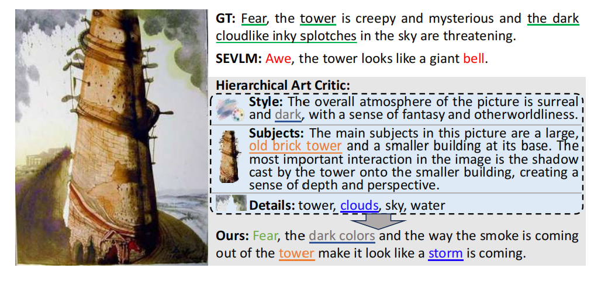
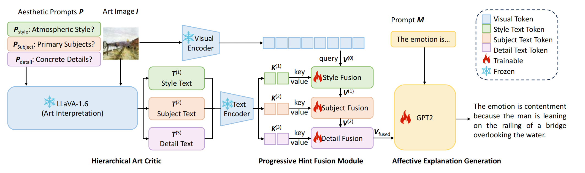

# ProFocus

**ProFocus: Interpreting Affective Experience in Artistic Images with Progressive Visual Focusing**

Zhiyan Zhang, Zicheng Yan, Jianqi Chen, Peipei Song, Shanshan Wang, and Xun Yang

[Paper (arXiv:2608.13974)](https://arxiv.org/abs/2608.13974) · [Code](https://github.com/Zhang-Zhiyan/ProFocus)

This repository releases the ProFocus source code and precomputed visual text guidance. ProFocus predicts the emotion evoked by an artwork and generates a natural-language explanation.

**Release status:** source release. Trained checkpoints and the original complete environment are not included. End-to-end training, inference, and reproduction of the paper's reported scores have not been verified for this release. See [reproducibility notes](docs/REPRODUCIBILITY.md) for remaining requirements and known differences between the training and evaluation code.



## Method

The **Hierarchical Art Critic (HAC)** uses LLaVA-1.6 to provide three kinds of guidance: atmospheric style, narrative subjects, and concrete details. **Progressive Hint Fusion (PHF)** injects the guidance into visual features in this order. The model builds on a CLIP ViT-B/16 image encoder and GPT-2 decoder, with language-modeling, contrastive, and valence/arousal/dominance (VAD) losses.



## Repository contents

```text
ProFocus/
├── train.py                         # Training and validation
├── test.py                          # Checkpoint evaluation
├── co_attention_layer_improved.py   # Progressive hint fusion
├── models/                         # GPT-2, CLIP, and VAD modules
├── utils/                          # Data loading, options, and VAD features
├── llava1.6_results/                # Precomputed three-stage guidance
├── image/                          # Method illustrations
├── requirements.txt
├── docs/REPRODUCIBILITY.md
└── THIRD_PARTY.md
```

## Environment

Use a separate environment. Linux, Python 3.10, and an NVIDIA GPU with a CUDA-compatible driver are a proposed starting point for the included PyTorch 1.13.0 / CUDA 11.7 dependency family; this is not an exported or validated paper environment.

```bash
python -m venv .venv
source .venv/bin/activate
python -m pip install --upgrade pip
python -m pip install -r requirements.txt --extra-index-url https://download.pytorch.org/whl/cu117
```

CLIP is specified in `requirements.txt` at a fixed upstream commit and requires Git to install. GPT-2 and CLIP pretrained weights are downloaded on first use unless already cached. For offline training, pass a local Hugging Face GPT-2 directory with `--base_model /path/to/gpt2` and prepare the CLIP cache separately.

Caption evaluation accepts the original `cococaption` package, if supplied, or `pycocotools` and `pycocoevalcap`. The original evaluator fork and revision were not provided. The historical [tylin/coco-caption](https://github.com/tylin/coco-caption) repository targets Python 2.7, so cloning it alone is not a Python 3 setup procedure. Evaluation also needs Java and the tokenizer/metric assets required by the selected evaluator. Matching scores across evaluator versions has not been verified.

Download the NLTK resources used by the installed NLTK version before training or inference:

```bash
python -m nltk.downloader wordnet omw-1.4 averaged_perceptron_tagger averaged_perceptron_tagger_eng
```

## Prepare resources

Run the commands below from the repository root.

### ArtEmis annotations

The supplied code expects preprocessed JSON files under `data/`:

```text
data/
├── artEmisX_cl_train.json
├── artEmisX_val.json
└── artEmisX_test.json
```

The supplied archive points to [this Hugging Face dataset directory](https://huggingface.co/datasets/aphrorahf/artemis_for_ProFocus/tree/main/dataset). Its availability, exact version, and correspondence to the paper's ArtEmis v1/v2 splits have not been verified for this release. No annotations are bundled here. Use the appropriate dataset terms and preserve the published splits; do not create a new random split when comparing with paper results.

Each file is a JSON object keyed by numeric image IDs represented as strings. Samples use `image_name`, `emotions`, and `explanations`; evaluation also reads `image_emotion_distribution` and `origin_emotion_distribution`. The contrastive training loader requires at least two distinct emotion labels for each training image. See `utils/datasets.py` for the exact schema.

### WikiArt images

Obtain the corresponding images through the [WikiArt dataset resource](https://github.com/cs-chan/ArtGAN/tree/master/WikiArt%20Dataset), subject to its terms. The original preparation notes resize the longer side to at most 600 pixels while retaining the aspect ratio. Place images under:

```text
wikiart_rescaled_max_size_to_600px_same_aspect_ratio/<image_name>.jpg
```

The loader appends `.jpg` to each annotation's `image_name`, including any relative subdirectories in that field. Override the directory with `--image_root /path/to/images` or the `PROFOCUS_IMAGE_ROOT` environment variable. Images are not distributed in this repository.

### NRC-VAD lexicon v1

Download **NRC-VAD v1** from [the resource author's page](https://saifmohammad.com/WebPages/nrc-vad.html) and read its terms. The lexicon data is excluded because the terms accompanying the supplied archive prohibit redistribution.

Extract the bipolar-scale lexicon to:

```text
utils/NRC-VAD-Lexicon/BipolarScale/NRC-VAD-Lexicon.txt
```

Alternatively, set the file location explicitly:

```bash
export NRC_VAD_LEXICON=/path/to/BipolarScale/NRC-VAD-Lexicon.txt
```

Keep the bipolar values used by this code; replacing them with the unscaled lexicon changes the VAD features.

### HAC text guidance

The `llava1.6_results/` directory contains the supplied per-style JSON files. Successful records contain `image_name`, `visual_analysis`, `subject_description`, and `striking_details`. The loaders match these records to annotation image names. Missing guidance falls back to the prompt text, so check the reported coverage before comparing results.

The generation code and exact HAC prompts were not included in the archive. This release supports using the supplied guidance; regeneration is not yet documented.

## Training

After preparing all resources and the evaluator:

```bash
accelerate launch --num_processes 1 train.py \
  --image_root ./wikiart_rescaled_max_size_to_600px_same_aspect_ratio \
  --base_model gpt2 \
  --ckpt_path ./ckpts \
  --caption_save_path ./results
```

Training uses `artEmisX_cl_train.json` and validates on `artEmisX_val.json` by default. Options are defined in `utils/opts.py`. Current defaults include 25 epochs, batch size 8, learning rate `2e-5`, maximum sequence length 40, and loss weights `alpha=1.0`, `cl_Loss_weight=1.5`, and `VAD_Loss_weight=1.0`. These are code defaults, not a confirmed record of every paper experiment. Boolean options accept explicit values such as `--use_text_guide false`.

## Checkpoint evaluation

**No trained checkpoint download is available in this release.** Evaluation requires a matching checkpoint obtained from the authors or produced by training. A `best-res` checkpoint has this layout:

```text
ckpts/
├── nle_model_best-res/       # Decoder weights and config.json
├── nle_gpt2_tokenizer_0/     # Tokenizer and added special tokens
└── ckpt_stats_best-res.tar   # Fusion/VAD states and training metadata
```

The stats archive must include the trained `fusion_module_state_dict` and, when VAD is enabled, the matching `emo_encoder_state_dict`. An image encoder state is needed if the encoder was fine-tuned. A decoder alone is insufficient for a ProFocus evaluation. The current loader initializes fusion weights if their state is absent; such a run does not evaluate the trained ProFocus model.

```bash
python test.py \
  --load_from_epoch best-res \
  --ckpt_path ./ckpts \
  --image_root ./wikiart_rescaled_max_size_to_600px_same_aspect_ratio \
  --caption_save_path ./test-results
```

`best-acc` can be selected with the same flag and matching filenames. Generated captions, features, and scores are written to the chosen result directory. Test annotations are converted into COCO-style references if `--annFileExp` does not already exist. Use a distinct reference file when switching dataset versions or splits.

## Citation

```bibtex
@misc{zhang2026profocus,
  title         = {ProFocus: Interpreting Affective Experience in Artistic Images with Progressive Visual Focusing},
  author        = {Zhiyan Zhang and Zicheng Yan and Jianqi Chen and Peipei Song and Shanshan Wang and Xun Yang},
  year          = {2026},
  eprint        = {2608.13974},
  archivePrefix = {arXiv},
  primaryClass  = {cs.CV},
  url           = {https://arxiv.org/abs/2608.13974}
}
```

## License and acknowledgements

The repository's project license is [Apache-2.0](LICENSE). Third-party code, pretrained models, datasets, and the NRC-VAD lexicon retain their own terms; see [THIRD_PARTY.md](THIRD_PARTY.md).

The supplied implementation credits [SEVLM](https://arxiv.org/abs/2403.11150), [NLX-GPT](https://github.com/fawazsammani/nlxgpt), [Hugging Face Transformers](https://github.com/huggingface/transformers), and [OpenAI CLIP](https://github.com/openai/CLIP). NRC-VAD was created by Saif M. Mohammad at the National Research Council Canada. Please cite the corresponding resources when using them.

